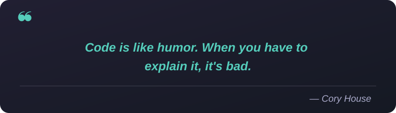

<!-- H1: Green - Animated once, stays visible -->
<h1 align="center">
  
</h1>

<!-- H2: Blue - Animated once, stays visible -->
<h2 align="center">
  
</h2>

<!-- H3: Blue - Types and erases each phrase -->
<h3 align="center">
  
</h3>

## 💻 Tech Stack

### 🎨 Frontend Development

### ⚙️ Backend Development & Databases

### 🛠️ Other Tools & Technologies

### 🔗 Connect With Me

  
  
  

### 📊 GitHub Stats

  
  

### 📈 Contribution Graph

  

## 💡 Dev Quote

  

⭐ From [abebawwebebe](https://github.com/abebawabebe)

